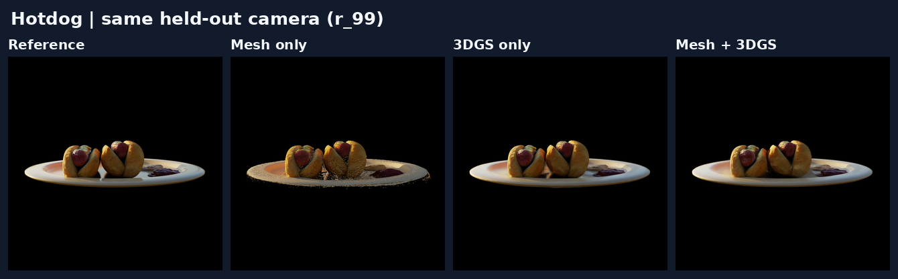
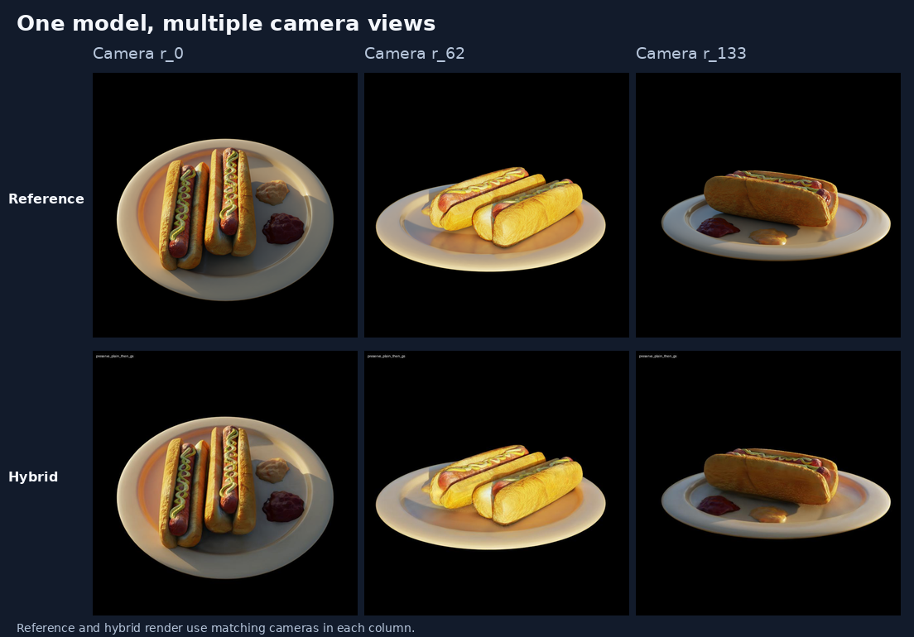

# HybridRepre

基于 Mesh 与 3D Gaussian Splatting 的混合三维重建项目，包含 Mesh 几何与神经外观优化、局部网格调整、混合渲染，以及 UV 展开和贴图导出。

<!-- results-showcase:start -->
## 结果展示

### 同视角渲染对照

Hotdog 场景，同一相机视角下依次展示**参考图、仅 Mesh、独立 3DGS 与 Mesh–3DGS 混合渲染**。

Mesh 列为混合优化后网格分支的单独渲染，3DGS 列为独立训练的高斯模型。



### 多视角结果

同一模型在不同相机下的外观。每一列的参考图与混合渲染结果使用相同相机。



[参考图](docs/media/hotdog_gt.png) · [Mesh](docs/media/hotdog_mesh.png) · [3DGS](docs/media/hotdog_pure_gs.png) · [混合渲染](docs/media/hotdog_hybrid.png) · [样例说明](docs/media/samples.json)

展示图片来自已保存的 Hotdog 实验结果，原始单图可点击查看；图中对照均保留对应的同视角关系。
<!-- results-showcase:end -->

## 目录

```text
HybridRepre/       初始版本
HybridRepre2/      Mesh 优化、局部细化与简化、UV 烘焙实验
HybridRepre3/      Mesh 与 3DGS 混合渲染实验
third_party/      可微光栅化、网格处理及神经编码依赖源码
scripts/          环境与扩展安装脚本
```

三个版本分别保留原有入口和配置，在对应目录下运行。数据集、训练权重和渲染输出由使用者另行准备。

## 环境安装

使用 Linux、NVIDIA GPU 和 CUDA Toolkit，先安装与 CUDA 匹配的 PyTorch，再安装 Python 依赖和扩展：

```bash
git clone https://github.com/yeruoxiangchen/hybridrepre.git
cd hybridrepre
python -m pip install -r requirements.txt
bash scripts/install_extensions.sh HybridRepre3
source scripts/env.sh /data/hybridrepre
```

切换到 `HybridRepre2` 的自定义几何优化时，用 `bash scripts/install_extensions.sh HybridRepre2` 安装对应扩展。编译需要 `nvcc`、C++ 编译器和 Ninja。

## 数据

Mesh 优化使用多视图图像、前景掩码、相机参数和初始网格。LLFF 数据示例：

```text
/data/hybridrepre/data/object/
├── images/
├── masks/
├── poses_bounds.npy
└── mesh/
    ├── mesh.obj
    ├── mesh.mtl
    └── probe.hdr
```

3DGS 分支还支持其原生 COLMAP／Blender 相机与点云输入。修改 `configs/*.json` 中的 `ref_mesh`、`base_mesh`、`envmap` 和分辨率，使其对应自己的数据。

## 使用

Mesh 几何与外观优化：

```bash
cd HybridRepre2
python rendertest2.py --config configs/pineapple.json \
  --ref_mesh /data/hybridrepre/data/object \
  --base-mesh /data/hybridrepre/data/object/mesh/mesh.obj \
  --outputpath /data/hybridrepre/outputs/mesh
```

JSON 配置在命令行解析后加载，因此配置内的同名字段具有优先级。运行前请将示例配置的路径替换为实际输入。

混合渲染训练与渲染：

```bash
cd ../HybridRepre3
python train3dgs.py --config configs/pineapple_nvdiff_with_mesh.json \
  -s /data/hybridrepre/data/object \
  -m /data/hybridrepre/outputs/hybrid --iterations 10000
python render3dgs.py --config configs/pineapple_nvdiff_with_mesh.json \
  -m /data/hybridrepre/outputs/hybrid
```

`train.py` 提供 Mesh／材质训练入口，`trainalpha.py` 提供不透明度优化实验，`gaussian_splatting/train.py` 保留独立 3DGS 训练入口。`trainblender.py` 等文件保留历史联合训练原型。

历史 GUI／NeRF 入口的附加依赖见 `requirements-optional.txt`；Frosting 渲染入口使用 [Frosting](https://github.com/Anttwo/Frosting) 的 `frosting_scene`、`frosting_utils` 和 `gsplat_wrapper` 组件。

## 第三方代码

基于 nvdiffrec、3D Gaussian Splatting、nvdiffrast、PyTorch3D 和 tiny-cuda-nn 等项目构建。第三方源码保留各自版权与许可证，参见 [THIRD_PARTY.md](THIRD_PARTY.md)。
